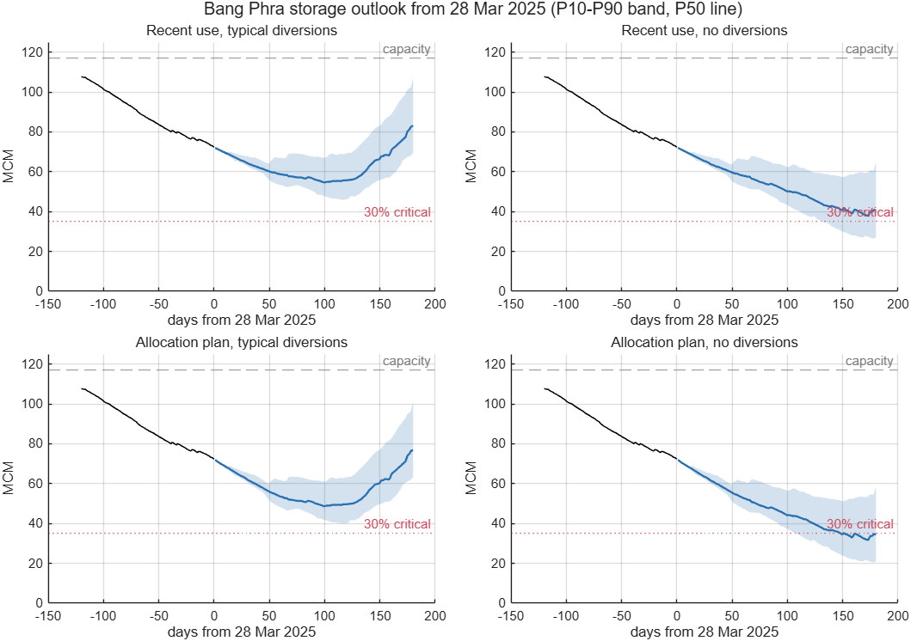
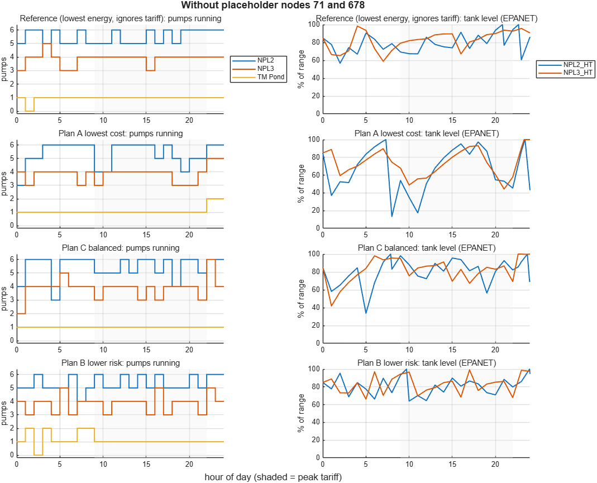
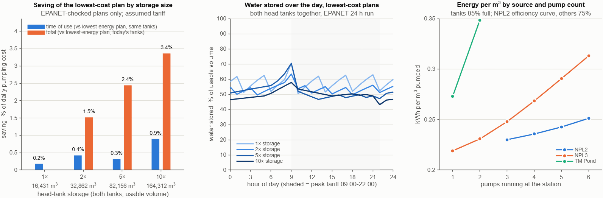

# POC Report: AI for Demand & Supply Optimization

**Eastwater proof of concept: final report, draft for review**

| | |
|---|---|
| Date | 16 October 2026 |
| Version | Draft 1.1: adds the storage what-if and cost per m³ by source |
| For | Eastwater executive sponsor, operations, data owners and hydraulic-model owner |
| Basis | POC analysis outputs at commit `0cb9d3d` of the POC repository, the storage what-if (`reports/matlab/whatif_storage_sources.md`), and the proposal deck *AI for Demand & Supply Optimization* v3 |
| Confidentiality | Contains Eastwater data shared under NDA. Do not circulate outside the NDA. |

**Reading guide.** For a 10-minute read: Section 1, then Sections 7.3 and 8. Each figure carries a source tag such as [PP]; Appendix A maps each tag to its file. *Derived* marks simple arithmetic on sourced figures, with the sum shown. Assumptions are tagged A1 to A11 (Section 2.3). The Go/No-Go thresholds in Section 7 are proposals to agree with Eastwater, not results.

**Contents.** 1 Executive summary · 2 Scope, data and assumptions · 3 Demo recommendation · 4 Baseline KPIs · 5 Data-gap report · 6 Validation report · 7 Go/No-Go criteria for QW1–QW4 · 8 Pilot area · 9 Risks and mitigations · 10 Next steps · Appendix A Sources · Appendix B Glossary

---

## 1. Executive summary

**What we tested.** The proposal's decision chain: forecast demand, optimise pumping into Plans A, B and C, check each plan in a pipe-network model (EPANET), then let the operator decide [DECK 3]. Forecasting was tested on the Bang Phra reservoir daily report (Chonburi, 1990–2025) [DQ] and pump planning on the EPANET model of the Rayong network [EP], because the two data sets cover different areas.

| POC scorecard | Result | Source |
|---|---|---|
| Forecast error, PWA Chonburi draw, 1 / 7 days ahead | 3.4% / 4.5% | [BT] |
| Energy cost per m³, model, assumed tariff (A1) | 0.85 THB (tanks held lower); 0.92 (85% full); 0.96 (as supplied) | [WK, PK] |
| Plans A/B/C passing the hydraulic check | 1 of 3, 33% (Plan B; A and C rejected) | [PP] |
| Saving from off-peak pumping (model) | about 0%; at most 0.9% with 10× the tank storage | [RM, WI] |
| Saving from holding the head tanks lower (model) | 7.5% less energy, if Eastwater's tank limits allow | [WI] |
| Saving against today's operation | Unknown until Eastwater's data arrives | Section 5 |
| Computer time per full planning run | about 25 minutes, every plan checked | [RM] |

**What the POC shows**

1. **The hydraulic check is essential.** It rejected Plans A and C, two of the three cost-optimised plans. Plan A looked 3.3% cheaper, but would have left an elevated tank 8.3 m low and the customer Burapa below its pressure target [PP, RM].
2. **Off-peak pumping saves about 0%, and bigger tanks would not change that.** Even 10 times today's tank storage (about 16,400 m³, roughly 34 minutes of the model's full demand [RM]) saves only 0.9%, about 1.3 million THB a year before building costs [WI]. The limit is the pumps: running more at once raises the head they pump against (NPL3: 60 m with one pump, 86 m with six) [WI].
3. **The main saving lever found: hold the head tanks lower.** Keeping them only as full as the customer pressure floors need uses 7.5% less energy than starting and ending the day 85% full (412,713 against 448,393 THB/day at the assumed tariff); both plans pass the hydraulic check [WI, PP]. No new assets are needed, but less water stays in reserve, so it is Eastwater's operating decision: NPL3_HT must stay above about 35% full (55% with no TM Pond pump running) [WI]. Source choice is the next lever: NPL3 with one pump uses 0.219 kWh/m³, TM Pond with two 0.348 [WI].
4. **There may be a capacity gap.** At the model's full demand of 688,403 m³/day, the NPL3 tank drains by about 18,600 m³/day even with all 14 usable pumps [PP, RM]. Either nodes 71 and 678 (100,000 m³/day each) are placeholders, or the NPL3 zone is short of capacity [EN, RM].
5. **Forecasting works where demand is steady:** 3.4% average error a day ahead for PWA Chonburi's draw; the AI model needs known future events, such as contract changes, to beat simple methods [BT, RM]. Without diversions, Bang Phra's chance of falling below 30% within 180 days rises from 0% to 43% (60% at planned use) [SO].

**Not yet known: the saving against today's operation.** The savings above compare model plans with each other. Without pump logs, electricity bills, the actual tariff and customer meter data, today's cost per m³ is unknown. The proposal's 3–5% saving remains an illustration, not a commitment [DECK 5].

**Recommendation: conditional Go, with Rayong as the pilot area.** Rayong is the only area with a pipe model, which QW2 and QW3 need (Section 8). **Go** for QW1, and for confirming and calibrating the pipe model, once the Section 5 data arrives. **Hold** QW2 and QW4 until today's cost per m³ is measured; QW2 should then target tank levels and source choice rather than off-peak shifting (Section 7).

**Decisions needed from Eastwater:** (1) confirm Rayong as the pilot area; (2) name an owner for each of the seven priority data items (Section 5); (3) set the minimum operating level of each head tank, and have the model owner confirm nodes 71 and 678, TM Pond pumps 3–6 and the source reservoir levels; (4) agree the KPI thresholds (Section 7); (5) schedule an operator walkthrough of the demo (Section 3).

---

## 2. Scope, data and assumptions

### 2.1 What the POC had to deliver

Slide A2 of the proposal lists four outputs for the 4–6-week POC [DECK A2].

| POC output [DECK A2] | Section | Status |
|---|---|---|
| Demo recommendation for one area | 3 | Done for Rayong on model data; not yet on a real operating day |
| Baseline KPIs and data gaps | 4, 5 | KPIs measured on the model and the reservoir data; today's cost and the saving need Eastwater's data |
| Validation report | 6 | Done |
| Go/No-Go criteria for QW1–QW4 | 7 | Proposed; thresholds to be agreed with Eastwater |

### 2.2 Data used

| Data | Area | Content | Limits | Source |
|---|---|---|---|---|
| Bang Phra reservoir daily report (RID), sheet `WB บางพระ` | Chonburi | Daily level, storage, inflow, evaporation, diversions and water drawn by each user (PWA Chonburi, Eastwater, Thai Oil, EGAT and others): 12,871 days, 1 Jan 1990 to 28 Mar 2025 | Water drawn from the reservoir, not delivered to customers; ends 28 Mar 2025 | [DQ, RM] |
| Bang Phra allocation plan, water year 2024/25 | Chonburi | Planned daily draw per user | One water year | [DQ, RM] |
| EPANET model `Demand-2023 v20RY to MTP new TM2P.inp` | Rayong | 1,416 junctions, 1,373 pipes, 18 pumps, 49 valves, 3 source reservoirs, 2 elevated (head) tanks, 28 customer demand nodes totalling 688,403 m³/day | One fixed demand per node; no demand patterns, controls or energy prices | [EP] |

No pump logs, electricity bills, tariff, customer meter or SCADA data were available. Because the two data sets cover different areas, the full chain has not yet run on one area with real data.

### 2.3 Assumptions register

Every result that depends on an assumption carries its tag.

| Tag | Assumption | Used in | Closed by (Section 5 item) | Source |
|---|---|---|---|---|
| **A1** | **Assumed tariff.** 4.1839 THB/kWh peak (09:00–22:00) and 2.6037 THB/kWh off-peak, applied to one weekday. Energy charge only: no peak-demand charge, Ft or service charge (cost = pump energy × hourly rate, `matlab/validate_plan.m`). | Every THB figure | 3 | [PP] |
| **A2** | **Flat demand.** The model has no demand patterns, so every hour of the simulated day is identical. | EPANET checks, pump plans | 4, 5 | [EP, PP] |
| **A3** | **Placeholder nodes 71 and 678.** Each carries 100,000 m³/day. The 488,403 m³/day scenario removes both as presumed placeholders; this is not confirmed. | Demo recommendation, cost per m³ | 7 | [EN, PP] |
| **A4** | **Pump efficiency 75%** (the model's global setting) for every pump in the pump plans and the storage what-if, and every pump available. The cost-by-source comparison uses the model's NPL_2-Eff curve for NPL2 (74–82%) and 75% for NPL3 and TM Pond, which have no curve. | All kWh and THB figures | 2, 6 | [PP, WI] |
| **A5** | **TM Pond pumps 3–6 unusable.** In EPANET they cannot deliver the head, so at most 2 of the 6 TM Pond pumps can run. Whether they are standby units is unconfirmed. | Capacity, pump plans | 7 | [PP, RM] |
| **A6** | **Source reservoir heads as modelled** (43.41 m and 23 m), which sit below the pump suction pipes. | Suction pressures, pump output | 7 | [RM] |
| **A7** | **Operating limits set by the POC team.** In the pump plans, tanks start at 85% of their range; all plans stay below 90%; customer pressure floor 10 m, or the model's own minimum where it is already lower (Burapa, IEAT4/5/6); each plan must end the day at least as full as it started. | Pump plans, storage what-if | 10 | [PP, WI] |
| **A8** | **Reservoir draws stand in for demand.** The Excel shows water drawn from Bang Phra, not water delivered to customers. | Forecast accuracy | 4 | [DQ, RM] |
| **A9** | **Supply outlook inputs.** The 35 past inflow years are treated as equally likely; diversions and releases are averages, not responses to storage; evaporation is computed, not measured. | Supply risk outlook | 9 | [SO, DQ] |
| **A10** | **Illustrative business case.** The proposal's 3–5% saving and about 15 million THB a year (from an assumed 500 million THB energy bill and a 3% saving) are illustrations, not commitments. | Business case | 1–4 | [DECK 5] |
| **A11** | **Lower tank levels.** The lower-tank plan keeps NPL2_HT at 46–56% and NPL3_HT at 49–70% of their range, only as full as the customer pressure floors need, and the optimiser chooses the level the day starts at. Eastwater's minimum operating levels are not known. | Demo recommendation, cost per m³ | 7, 10 | [WI] |

---

## 3. Demo recommendation: Rayong network

This is the proposal's recommendation card [DECK 3], produced by the POC on the Rayong model. It demonstrates the workflow on model data; it is not an instruction for real operation.

**Situation.** One weekday at 488,403 m³/day: the model's demand without nodes 71 and 678 (A3), flat through the day (A2), at the assumed tariff (A1). Each schedule was optimised and then checked in a 24-hour EPANET run [PP, WI]. The first holds the head tanks only as full as the customer pressure floors need (A11) [WI]; the others start and end the day with both tanks 85% full [PP].

| Option | Hydraulic check | Energy cost THB/day | Cost vs lowest-energy plan, tanks 85% full | THB/m³ | Lowest customer pressure, m | Tank reserve | Pump starts | Source |
|---|---|---|---|---|---|---|---|---|
| **Lowest-energy plan, tanks held lower (recommended once Eastwater confirms the tank levels)** | Pass | 412,713 | −8.0% (derived: 412,713 ÷ 448,393 − 1) | 0.845 | 9.9 | 10%; held at 46–56% (NPL2_HT) and 49–70% (NPL3_HT) | 6 | [WK, WI, PK] |
| **Lowest-energy plan, tanks 85% full (until then)** | Pass | 448,393 | — | 0.918 | 11.7 | 10% | 12 | [PK, PP] |
| Plan B, lower risk | Pass | 449,391 | +0.2% | 0.920 | 13.7 | 50% | 23 | [PK] |
| Plan C, balanced | **Rejected** | 447,507 | −0.2%, not valid (derived: 447,507 ÷ 448,393 − 1) | 0.916 | 9.0 | 30% | 20 | [PK, PP] |
| Plan A, lowest cost | **Rejected** | 433,506 | −3.3%, not valid | 0.888 | 9.0 | 10% | 14 | [PK, PP, RM] |

*Customer pressure floors are 10 m, or the model's own minimum where it is already lower (A7). Tank reserve: the lowest level each elevated tank may reach, as a share of its range. Rejected: graded Warning, and no version of the plan passed within the optimise-and-check rounds [PP].*

**Recommendation to the operator.** Once Eastwater confirms the head tanks may run this low, run the lowest-energy plan with the tanks held lower: 119,510 kWh/day and 0.2447 kWh/m³ (0.845 THB/m³), 8.0% cheaper than holding the tanks 85% full, and it passes the hydraulic check [WK, WI]. NPL3_HT must stay above about 35% full for every customer to keep its pressure floor (55% with no TM Pond pump running) [WI]. A tariff-aware version saves a further 0.2% (411,982 THB/day), within the optimiser's tolerance [WI]. Until the tank levels are confirmed, run the lowest-energy plan with the tanks 85% full (448,393 THB/day, 0.264 kWh/m³) [PK]. Choose Plan B instead if a larger tank buffer is worth about 1,000 THB/day (derived: 449,391 − 448,393): it keeps both tanks at least half full, at the price of 23 pump starts instead of 12 [PK].

**Why the two lowest-energy plans differ.** The pumps lift against less head when the tanks are lower. At 10 times today's storage, the lowest-cost plan costs 9.2% more than the lowest-energy plan for that size when it must start the day 85% full, against 0.9% less when it may choose its start level [WI]. The two runs also model the tanks differently: the what-if lets tank inflows depend on tank level and lets the optimiser choose the start level, while `optimize_pumps.m` plans on inflows measured near full and starts both tanks at 85% [WI].

**Why not the cheaper-looking Plans A and C.** Plan A would save 3.3% on paper [RM]. In EPANET, tank NPL2_HT ended the day 8.3 m below its starting level, pumps were forced off because they could not deliver the head, and Burapa fell below its pressure target. Plan C also left Burapa below target, and NPL2_HT 2.9 m low [PP]. Both are reported as rejected, not as savings.

**Why off-peak pumping does not pay here.** Pumping ahead of the 09:00–22:00 peak means running more pumps at once off-peak, which raises the head every pump works against and uses up most of the off-peak discount [WI]; the small elevated tanks (about 16,400 m³) and the customer pressure floors limit it further [RM, WI]. Even Plan A only cut the average number of pumps running in peak hours from 10.4 to 9.9 [PK]. Bigger tanks would not change this (Section 6.6).

**At the model's full demand (688,403 m³/day) there is no recommendation.** No schedule keeps the tanks within limits and repeats daily: tank NPL3_HT drains by about 775 m³/h, about 18,600 m³/day, even with all usable pumps running [PP, RM]. That is a capacity question for Eastwater, not a scheduling one (Section 9, risk 4).

**Still needed for a real recommendation:** today's operation as the comparison (the proposal's "current plan = 100%" [DECK 3]), the real tariff, real demand patterns, Eastwater's minimum tank levels and a calibrated model (Section 5). In every pump-plan run, at least 27 junctions at the pump suctions show negative pressure (27 for both passing plans), which traces to the modelled source reservoir heads (A6) [PP, RM].

---

## 4. Baseline KPIs

The proposal names four KPIs to agree before the project starts [DECK 4]. The table shows what the POC could measure now, and what cannot be measured until Eastwater's data arrives.

| KPI [DECK 4] | Measured in the POC | Basis | Not measurable until Eastwater's data arrives |
|---|---|---|---|
| **Cost per m³** (pumping energy) | **0.96 THB/m³** (0.278 kWh/m³; 191,207 kWh and 660,897 THB a day) for the model as supplied at 688,403 m³/day, graded Warning [PK]. **0.918 THB/m³** (0.264 kWh/m³) for the cheapest plan that passes with the tanks 85% full, at 488,403 m³/day [PK, PP]. **0.845 THB/m³** (0.2447 kWh/m³) for the lowest-energy plan with the tanks held lower, which also passes (A11) [WK, WI]. | Model (A1–A4). Three pump stations: NPL2, NPL3 and TM Pond [EP]. Divided by modelled demand, not metered deliveries. | Today's actual energy cost per delivered m³, the proposal's definition [DECK A9] (items 1–4). |
| **Saving vs today's operation** | **Not measurable.** Model-only evidence: off-peak shifting saves about 0%. The only valid tariff-aware plan cost 0.2% more than the lowest-energy plan in the final run; −0.4% to +0.6% across all runs [RM, PK]; at most 0.9% even with 10 times the tank storage [WI]. Holding the tanks lower uses 7.5% less energy than holding them 85% full [WI]. | Compared with other model plans, because today's operation is unknown. | Today's operation and the real tariff (items 1–3), replayed on real days. |
| **Forecast accuracy** | Daily draw, PWA Chonburi: **3.4%** error 1 day ahead, **4.5%** 7 days ahead. Total daily draw, all users: **5.2%** (1 day) to **8.8%** (7 days). Storage 30 days ahead: **3.49 MCM** average error [BT, SO], 3.0% of the 117 MCM capacity (derived: 3.49 ÷ 117.0) [DQ]. | Bang Phra reservoir draws, tested from 2022 (demand) and 2019 (storage) (A8). | Accuracy on the pilot network's customer deliveries, at Eastwater's planning horizons (items 4, 11). |
| **Plans passing the hydraulic check** | At 488,403 m³/day: **2 of 4** schedules pass, 50% (lowest-energy plan, Plan B); of Plans A, B and C, **1 of 3**, 33%. At 688,403 m³/day: **0 of 4**, 0% (no feasible schedule); the model's own operation grades Warning [PP]. Storage what-if, which models tank inflows by tank level: **9 of 9** plans pass on the first EPANET check [WI]. | 24-hour EPANET check against the A7 limits. | Pass rate on real operating days with a calibrated model (items 5, 7). |
| **Planning time** | Computer time: **about 25 minutes** for a full run: two demand scenarios, four schedules each, 343 pump-station combinations simulated per scenario, every plan checked in EPANET [RM, PP]. The storage what-if script (four tank sizes, nine plans, plus the cost tables) ran in 34 minutes [WI]. | Analysis PC; optimiser stops within 0.5% of the best cost, 300 s limit per solve [RM]. | Today's manual planning time (item 11). |

**Data readiness:** none of the seven priority data items in Section 5 has been received (status at 16 Oct 2026).

---

## 5. Data-gap report

The proposal makes data readiness a key condition for the timeline, and asks the POC to list missing data in a data-gap report [DECK A7]. Owners below are the roles the proposal names [DECK A11] or the likely department; Eastwater should confirm each one.

**Priority items** (needed before QW1–QW3 can be judged; the gates in Section 7 refer to these numbers)

| # | Item | Why it is needed | Likely owner at Eastwater (to confirm) | Format and period wanted |
|---|---|---|---|---|
| 1 | **Today's pump operation logs** | Defines "today's operation", the baseline every saving is measured against [DECK 4]. Lets us replay real days through the planner and shows which pumps are really available. | Operation SME / control room (SCADA historian) | One row per pump per hour (15-minute if available): on/off, flow, discharge pressure, power if logged. CSV or Excel. 24 months (12 minimum), same period as item 2. |
| 2 | **Electricity bills or kWh per pump station** | Gives the actual energy cost and kWh per m³. Tests the model's 75% pump efficiency (A4) [PP] by comparing modelled with metered kWh. | Finance (bills); electrical or energy engineer (sub-meters) | Monthly bills for every electricity account, 24 months, with a list mapping accounts to stations and any non-pump loads (offices, treatment, lighting) on each meter. Interval meter data (15- or 30-minute) for the latest 3–12 months if available. |
| 3 | **The real tariff** | Every THB figure uses an assumed rate (A1). The peak-demand charge and Ft can change which plan is cheapest. | Finance / procurement (electricity supply contract) | Tariff category per account: time-of-use energy rates and hours, peak-demand charge (THB/kW), Ft for each billing period, service charges, holiday calendar. Current, plus the last 24 months. |
| 4 | **Water delivered to each customer** | The Excel shows water drawn from reservoirs, not deliveries (A8). Customer meters give the demand to forecast (QW1), the delivered volume for cost per m³ [DECK A9], and real hourly patterns to replace the flat demand (A2). | Commercial / customer billing and metering | Per customer meter: daily for at least 3 years; hourly for at least the latest 3 months. A table mapping each meter to its EPANET node. |
| 5 | **SCADA tank levels and pressures** | Calibrates the EPANET model (QW3 gate). Answers whether NPL3_HT really drains, and whether IEAT4/5/6 and Burapa really get less than 10 m [EP, EN]. | Operation SME / SCADA team | Hourly (15-minute if available) for tanks NPL2_HT and NPL3_HT, station flows and pressures, and customer-node pressures, with a tag list and units. 12 months (3 minimum), same period as item 1. |
| 6 | **Pump power and efficiency** | The model applies one 75% efficiency to every pump (A4) [PP]. Only NPL2 has an efficiency curve in the model, so the cost ranking of NPL3 and TM Pond rests on that 75% [WI]. Real pump curves set kWh per m³ and show which pump combinations are cheapest, a saving lever beyond the tariff. | Mechanical / maintenance engineering (asset register) | Per pump: manufacturer curves (flow, head, efficiency), motor rating, variable-speed drive or not, latest efficiency test, duty or standby, planned maintenance windows. |
| 7 | **Model confirmations: nodes 71/678, TM Pond pumps 3–6, source reservoir heads, head-tank operating range** | Nodes 71 and 678 carry 200,000 of the model's 688,403 m³/day and decide whether the NPL3 zone is about 18,600 m³/day short [EN, PP]. TM Pond pumps 3–6 can never run in the model (A5). The source heads (43.41 m and 23 m) sit below the suction pipes, giving 27 junctions negative pressure (A6) [EP, RM]. The lower-tank saving (7.5% of energy in the model) depends on how low operations will let NPL2_HT and NPL3_HT run (A11) [WI]. | Hydraulic model owner; operations for the tank levels | Written answers plus a corrected `.inp` file; the normal operating level range of each source reservoir; the minimum and maximum operating level of each head tank; any customers the three stations supply that are not among the model's 28 nodes [EP]. |

**Supporting items** (improve accuracy and widen the saving levers)

| # | Item | Why it is needed | Likely owner (to confirm) | Format and period wanted |
|---|---|---|---|---|
| 8 | **Known demand changes:** allocation plans, contract changes, new customers | Most forecast error comes from step changes that history cannot predict, such as PWA Chonburi rising from about 155,000 to 205,000 m³/day in April 2022 [RM]. | Commercial / planning | Dated list covering the period of item 4, plus the next 12 months. |
| 9 | **Raw-water storage feeding the pilot network; Bang Phra report after 28 Mar 2025** | The pump-plan run pointed to upstream raw-water storage as room to shift pumping [RM]; it is the one storage lever not yet tested, since Section 6.6 rules out bigger head tanks [WI]. Newer Bang Phra data lets us check the 180-day outlook (Section 6.3) against what actually happened. | Water resources / operations planning | Daily level, storage and transfers for each source reservoir and raw-water pond (at least 5 years). The Bang Phra sheet `WB บางพระ` from 29 Mar 2025 to date. |
| 10 | **Operating rules and service targets** | The optimiser should use Eastwater's limits, not the POC team's (A7): minimum pressure per customer, tank limits, customer priority, maintenance windows [DECK A8]. | Operation SME | One page per station and customer group. |
| 11 | **Planning practice** | The KPIs need the forecast horizons planners actually use and the time they spend per plan [DECK 4]. | Operation planning | A short interview, plus a time log over 2 weeks. |

---

## 6. Validation report

### 6.1 Reservoir data quality (Bang Phra, Chonburi)

- **Coverage and consistency.** 12,871 daily records, 1 Jan 1990 to 28 Mar 2025 (278 pre-filled formula rows dropped). The sheet's own sums hold on 100% of days for total use and for outflow, and recomputed natural inflow matches within 1,000 m³ on 99.5% of days [DQ].
- **Errors removed.** Negative flows created by missing meter readings (for example PWA −12 million m³ on 28 Mar 2025), and outliers on 255 days of PWA Chonburi data and 158 days of total use [RM, DQ].
- **Known limits.** Evaporation is computed (surface area × monthly pan rate), not measured; 1990–99 storage reads 0.4–1.2 MCM higher because the level-to-storage table changed in 2000 [DQ, RM].
- **Plan vs actual.** From 1 Nov 2024 to 27 Mar 2025, users drew 78% of the allocation plan; PWA Chonburi drew 99% of its allocation and Eastwater 36% (40,720 against 113,369 m³/day) [DQ, RM]. An outlook built on planned use is therefore about 80,000 m³/day too pessimistic [RM].

### 6.2 Forecast backtests

**Method.** Rolling-origin backtests: every forecast uses only data available on the day it is made. Demand forecasts were tested from 1 Jan 2022 and storage forecasts from 1 Jan 2019, up to the end of the data in March 2025: 1,154 to 1,181 forecasts per demand horizon and 2,189 to 2,272 per storage horizon [BT, BM, DQ]. Demand error is WAPE (total absolute error ÷ total actual); storage error is the average absolute error in million m³ (MCM).

| Forecast | Horizon | Best simple method | AI model (GBM) | Better | Source |
|---|---|---|---|---|---|
| PWA Chonburi, daily draw | 1 day | 3.4% (yesterday's value) | 3.6% | Simple | [BT] |
| PWA Chonburi, daily draw | 7 days | 4.5% (7-day mean) | 4.6% | Simple | [BT] |
| Total daily draw, all users | 1 day | 5.2% (yesterday's value) | 5.9% | Simple | [BT] |
| Total daily draw, all users | 7 days | 8.9% (7-day mean) | 8.8% | AI, by 0.1 point | [BT] |
| Total draw over the next 28 days | 28 days | 8.5% (28-day mean) | 9.2% | Simple | [BT] |
| Thai Oil, total over the next 28 days | 28 days | 11.6% (91-day mean) | 17.8% | Simple | [BT] |
| EGAT Bang Pakong, total over the next 28 days | 28 days | 17.5% (28-day mean) | 21.5% | Simple | [BT] |
| Bang Phra storage | 7 days | 1.05 MCM (7-day trend) | 1.23 MCM | Simple | [BT] |
| Bang Phra storage | 30 days | 5.08 MCM (seasonal average) | 3.60 MCM | AI | [BT] |
| Bang Phra storage | 90 days | 12.32 MCM (seasonal average) | 9.29 MCM | AI | [BT] |

- **Demand: simple methods are hard to beat.** Most error comes from step changes in allocation that history cannot predict, such as PWA Chonburi rising from about 155,000 to 205,000 m³/day in April 2022; the AI model needs known future events (item 8) to add value [RM]. Thai Oil and EGAT draw in bursts and can only be forecast as weekly or 4-weekly totals, with 12–21% error [RM, BT].
- **Storage: the AI model beats the seasonal average** at 30 and 90 days (3.60 against 5.08 MCM; 9.29 against 12.32 MCM) [BT].
- **Ranges and reproducibility.** The MATLAB P10–P90 ranges contain 78–82% of actual values for daily demand and storage, close to the 80% target. MATLAB reproduces all 111 Python baseline results exactly, and the AI model to within about 0.1 error points for daily demand [RM, BT].

### 6.3 Supply risk outlook (Bang Phra)

The outlook simulates storage day by day once for each of the 35 past years' inflows (1990–2024), with use, diversions and releases set by scenario (A9) [SO, RM].

- **Accuracy (backtest 2019–2025).** Average error of the median outlook: 1.12, 3.49 and 8.15 MCM at 7, 30 and 90 days, against 1.23 / 3.60 / 9.29 for the AI model and 1.43 / 5.08 / 12.32 for the seasonal average [SO]. At 7 days the simple 7-day trend is still slightly better, at 1.05 MCM [BT].
- **The shortage warning works.** "Below 30% of capacity within 90 days" has a Brier skill of 0.62 over the historical base rate (0.93 at 30 days, 0.99 at 7 days) [SO].
- **Limits.** The ranges are too narrow: 63–65% of outcomes fall inside P10–P90, against an 80% target. The 90-day outlook runs about 4 MCM pessimistic (bias −4.27 MCM), probably because in practice diversions increase when storage is low [SO, RM].

**Outlook from 28 Mar 2025** (storage 72.3 MCM, 62% full; recent use 243,049 m³/day, the 28-day mean) for the next 180 days [SO]:

| Scenario | Median storage at 90 days, MCM | Chance of falling below 30% (35.1 MCM) within 180 days | First day the P10 path is below 30% |
|---|---|---|---|
| Recent use, typical diversions | 56.4 | 0% | Not within 180 days |
| Allocation-plan use, typical diversions | 50.5 | 6% | Not within 180 days |
| Recent use, no diversions | 52.8 | 43% | 6 Aug 2025 |
| Allocation-plan use, no diversions | 46.9 | 60% | 13 Jul 2025 |

Diversions from Bang Pakong and Phra Ong are what keep Bang Phra safe [RM]. The data end on 28 Mar 2025, so this outlook demonstrates the method. With data to date (item 9) it can be checked against what actually happened, and rerun for today.

*Figure 1. Bang Phra storage outlook from 28 Mar 2025 [SO].*

### 6.4 EPANET network check (Rayong)

- **The model runs.** 48 simulated hours with no EPANET warnings [EP]. Python and MATLAB agree within 0.005 m at all 28 customer nodes, and both EPANET back-ends give the same 191,207 kWh/day [RM].
- **It is not yet an operating model.**
  - No demand patterns, controls or energy prices, so every hour is identical and 14 pumps run continuously (A2) [EP, RM].
  - Both elevated tanks drain and never refill: NPL3_HT from 24.80 to 16.46 m, NPL2_HT from 20.00 to 17.93 m over 48 hours [EP].
  - Four customers on high ground get less than 10 m of pressure: IEAT4, IEAT5 and IEAT6 (6.6 m, at 58.6 m elevation) and Burapa (9.8 m, at 74.7 m) [EN].
  - 27 junctions at the NPL3 and TM Pond pump suctions show negative pressure (−1.6 m at NPL3, down to −5.65 m at TM Pond), because the source reservoir heads (43.41 m and 23 m) sit below the suction pipes (A6) [EP, RM]. EPANET does not warn about these junctions because they have no demand [EP].
  - TM Pond pumps 3–6 never run (A5) [EP]. Nodes 71 and 678 carry 100,000 m³/day each and, unlike the other 26 demand nodes, have numeric IDs instead of customer names (A3) [EN].
- **The plan checker grades the model's own operation Warning:** four customers below 10 m, and both tanks end lower than they start, so the schedule cannot repeat daily. Switching off the TM Pond pumps grades Fail: customers get negative pressure and both tanks empty within 3 hours [RM].

### 6.5 Pump plans checked in EPANET (QW2 prototype with the QW3 check)

- **Method.** For each hour, the optimiser (a mixed-integer linear program) chooses how many pumps run at each station, keeping the tanks between their reserve and 90% full. Each plan is then simulated in EPANET for 24 hours and graded Pass, Warning or Fail. If a plan misses, its reserve is raised and it is re-optimised, for up to six rounds [RM]. 343 station combinations were simulated per demand scenario; 105 are hydraulically valid, and at most 2 TM Pond pumps can run [PP].
- **At 488,403 m³/day (A3)** the lowest-energy plan and Plan B pass. **Plans A and C were rejected by the hydraulic check** (Section 3) [PP].
- **Off-peak shifting saves about 0%.** In the final run the only tariff-aware plan that passed (Plan B) cost 0.2% more than the lowest-energy plan; across all runs, valid tariff-aware plans ranged from −0.4% to +0.6% [RM, PK]. The pump-plan run put this down to the small elevated tanks (about 16,400 m³) and pointed to upstream storage or better pump efficiency [RM]. The storage what-if (Section 6.6) refines this: bigger head tanks would not help, because the limit is the head the pumps work against at high flow, and the level the tanks are held at is a larger lever [WI].
- **At 688,403 m³/day no plan is feasible.** With all usable pumps running (6 NPL2 + 6 NPL3 + 2 TM Pond), tank NPL2_HT gains about 7,110 m³/day but NPL3_HT loses about 18,591 m³/day [PP].
- **Solver limits.** The optimiser stops within 0.5% of the best possible cost. Some solves hit the 300-second safety limit, so exact figures can differ slightly between runs; the conclusions held in every run [RM].

*Figure 2. Pumps running (left) and tank levels in EPANET (right) for each plan at 488,403 m³/day; shading marks the peak tariff [PP].*

### 6.6 Storage what-if and cost per m³ by source

**Question and method.** Would bigger head tanks make off-peak pumping pay, and which source gives the cheapest water? The what-if re-plans the 488,403 m³/day weekday (A2, A3) at 1, 2, 5 and 10 times today's tank storage, at the assumed tariff (A1), and checks every plan in a 24-hour EPANET run [WI]. Today's tanks hold 16,431 m³ between their minimum and maximum levels: 48 minutes of this demand, or 34 minutes of the model's full 688,403 m³/day [WI, RM, EP]. Unlike Section 6.5, tank inflows, pump power and customer pressures depend on both tank levels (fitted on 16,464 EPANET snapshots), and the optimiser chooses the level the day starts at; the day must end at least as full [WI].

| Tank storage | Usable volume, m³ | Saving from off-peak pumping, same storage | Lowest-cost plan vs today's lowest-energy plan | kWh/m³, lowest-energy plan | Source |
|---|---|---|---|---|---|
| 1× (today) | 16,431 | 0.2% | 0.2% | 0.2447 | [WI] |
| 2× | 32,862 | 0.4% | 1.5% | 0.2417 | [WI] |
| 5× | 82,156 | 0.3% | 2.4% | 0.2388 | [WI] |
| 10× | 164,312 | 0.9% | 3.4% | 0.2386 | [WI] |

*Every plan passes EPANET. Savings under about 0.5% are within the optimiser's tolerance. With today's tanks the solves stop at the 300-second limit with a 2–3% gap; that is a weak bound rather than a poor plan, since a 20-minute solve improved the 1× lowest-energy plan by only 0.1% [WI].*

- **Bigger tanks would not make off-peak pumping pay.** The best case, 10 times today's storage (about 148,000 m³ more), saves 0.9%, about 1.3 million THB a year at the assumed tariff, before the cost of building it; no size reaches the 3–5% hoped for [WI].
- **The pumps, not the tanks, limit the shift.** Pumping more in the 11 off-peak hours means running more pumps at once, and more flow through the same discharge mains raises the head every pump works against: NPL3 lifts 60 m with one pump and 86 m with six. The last pump at each station adds water at 0.30 (NPL2), 0.47 (NPL3) and 0.46 (TM Pond) kWh/m³, against 0.245 on average in the lowest-energy plan, which uses up most of the 38% off-peak discount [WI].
- **What extra storage buys is steadier pumping.** The 10× lowest-cost plan costs 3.4% less per day than the lowest-energy plan for today's tanks (about 5.1 million THB a year), of which only 0.9 points come from off-peak pumping [WI].
- **Holding the tanks lower is the larger lever, and needs no new assets.** The lowest-energy plan for today's tanks keeps them only as full as the customer floors need (NPL2_HT 46–56%, NPL3_HT 49–70%) and uses 0.2447 kWh/m³, 7.5% less than the Section 6.5 plan that starts and ends the day 85% full (0.2644) [WI]. Customer pressure sets the limit: NPL3_HT must stay above about 35% full (55% with no TM Pond pump running) [WI].

**Cost per m³ by source and pump count.** EPANET snapshots of each station with both head tanks 85% full; energy only, at the assumed tariff [WI].

| Station (source level) | Pumps running | kWh/m³ | THB/m³ off-peak | THB/m³ peak | Pump efficiency used | Source |
|---|---|---|---|---|---|---|
| NPL2 (43.41 m) | 3–6 | 0.230–0.251 | 0.60–0.65 | 0.96–1.05 | Model's NPL_2-Eff curve, 74–82% | [WI] |
| NPL3 (43.41 m) | 1–6 | 0.219–0.313 | 0.57–0.82 | 0.92–1.31 | 75% assumed (A4) | [WI] |
| TM Pond (23.00 m) | 1–2 | 0.273–0.348 | 0.71–0.91 | 1.14–1.46 | 75% assumed (A4) | [WI] |

- **Cheapest water: NPL3 with one pump,** 0.219 kWh/m³ (0.57 THB/m³ off-peak, 0.92 at peak). **Dearest: TM Pond with two pumps,** 0.348 kWh/m³ (0.91 / 1.46 THB/m³). TM Pond draws from a reservoir at 23.00 m, 20 m below the other stations' sources, so it lifts further [WI].
- **Energy per m³ rises with the number of pumps running,** for the same reason as above. At full output NPL2 is the cheapest source and TM Pond the dearest [WI].
- **The ranking rests on an assumed 75% efficiency for NPL3 and TM Pond** (A4); pump tests (item 6) would confirm it [WI].

*Figure 3. Saving by storage size (left), water stored over the day in the lowest-cost plans (middle), and energy per m³ by source and pump count (right) [WI].*

---

## 7. Go/No-Go criteria for QW1–QW4

### 7.1 Where the POC stands against its own exit criteria

| POC exit criterion [DECK A2] | Status | Evidence |
|---|---|---|
| Enough data to do the calculation | **Partly met** | Enough to test forecasting (Chonburi) and the hydraulic check (Rayong); not enough for today's cost per m³ or the saving (Section 5, items 1–4). |
| Model results can be explained | **Met** | Every forecast is benchmarked against simple methods (Section 6.2); every plan carries Pass, Warning or Fail and the node or tank at fault (Section 6.5). |
| Users accept the first workflow | **Not yet tested** | Needs an operator walkthrough of Section 3 and the POC dashboard (`dashboard/poc_dashboard.html`). |

### 7.2 Phase gates

Each phase has an entry gate (Go to start) and an exit gate (success). The thresholds are proposals anchored on POC results; the proposal itself says KPI targets should be confirmed from the pilot area's baseline [DECK 4]. Durations are the proposal's [DECK 2].

**QW1: see demand ahead (8–10 weeks)**

| Gate | Criterion | Proposed threshold | Status today | Evidence |
|---|---|---|---|---|
| Entry | Delivery data | Daily metered deliveries for customers making up at least 90% of pilot-network demand, at least 24 months, mapped to EPANET nodes | Not met | Item 4 not received |
| Entry | Data completeness | At least 95% of days usable per customer after cleaning | Not assessed | Benchmark: Bang Phra total use had no missing days in 2022–2024 [DQ] |
| Entry | Known events | Allocation plans, contract changes and new customers listed for the data period and the next 12 months | Not met | Item 8 |
| Exit | Accuracy | Total pilot-network demand: WAPE at most 5% one day ahead and at most 9% seven days ahead, over a 12-month rolling backtest | Not measured on Rayong | POC benchmark on Bang Phra total draw: 5.2% and 8.8% [BT] |
| Exit | AI adds value | AI forecast WAPE at least 10% lower than the best simple method at the agreed horizon; otherwise the simple method feeds QW2 | Not met in POC | The AI model tied the simple methods [BT] |
| Exit | Uncertainty ranges | P10–P90 range holds 75–85% of actual values | Met on Bang Phra | 78–82% [RM, BT] |

**QW2: lower pumping cost (8–10 weeks)**

| Gate | Criterion | Proposed threshold | Status today | Evidence |
|---|---|---|---|---|
| Entry | Baseline cost established | Today's energy cost per delivered m³, from at least 12 months of bills or station kWh and the actual tariff | Not met | Assumed tariff only (A1) [PP] |
| Entry | Today's operation known | At least 3 months of hourly pump logs for all pilot stations, overlapping the bills | Not met | Item 1 |
| Entry | Model energy is right | Modelled kWh within ±10% of metered kWh for the same days | Not tested | 75% pump efficiency assumed (A4) [PP] |
| Entry | Model questions answered | Nodes 71/678, TM Pond pumps 3–6 and source heads confirmed | Open | Item 7 |
| Entry | Tank operating range agreed | Minimum and maximum operating level of each head tank set by operations | Not met | The lower-tank plan needs NPL3_HT above about 35% full [WI]; item 7 |
| Exit | Saving vs today | Replaying at least 30 real days at the real tariff, saving per delivered m³: **3% or more: Go. 1–3%: Go only on a re-based business case. Under 1%: No-Go for off-peak schedule optimisation;** re-scope to tank-level policy and source choice, which have model evidence (Section 6.6), and to pump efficiency | Not measurable | Model only: off-peak saving about 0%, at most 0.9% with 10 times the storage; tanks held lower use 7.5% less energy [RM, PK, WI] |
| Exit | Only checked savings count | 100% of claimed savings come from plans that pass EPANET | Met in POC | Plans A and C excluded [PP] |
| Exit | Run time | A day's plan set (reference plus Plans A/B/C, each checked) ready within 30 minutes | Met in POC | About 25 minutes for two demand scenarios [RM] |

**QW3: hydraulic check with EPANET (10–12 weeks)**

| Gate | Criterion | Proposed threshold | Status today | Evidence |
|---|---|---|---|---|
| Entry | SCADA data | At least 3 months of hourly tank levels, station flows and pressures, including the four low-pressure customers | Not met | Item 5 |
| Entry | Model owner sign-off | Written answers and a corrected model; demand patterns and controls added | Open | The model has 0 patterns and 0 controls [EP]; item 7 |
| Exit | Calibration | Simulated tank levels within ±1.0 m and customer pressures within ±2.0 m of SCADA for at least 85% of hourly readings, on a week not used for calibration | Not tested | — |
| Exit | Suction pressures | No negative pressure at pump suctions, or the cause confirmed as a model artefact | Not met | 27 junctions at −1.6 to −5.65 m [EP] |
| Exit | Plans passing | Over at least 30 replayed days: a passing plan on at least 95% of days, and at least 2 of Plans A/B/C passing on at least 80% of days | Not met | 1 of 3 at 488,403 m³/day; 0 of 3 at 688,403 m³/day [PP] |
| Exit | Explainable results | Every Warning or Fail names the node, tank or pump at fault | Met | [PP] |

**QW4: decision dashboard (6–8 weeks)**

| Gate | Criterion | Proposed threshold | Status today | Evidence |
|---|---|---|---|---|
| Entry | Earlier phases | QW1–QW3 exit criteria met, or waived in writing by the steering committee | Not yet | — |
| Entry | KPIs agreed | KPI definitions, baselines and thresholds signed off by Eastwater | Not yet | [DECK 4] |
| Entry | Planning-time baseline | Today's time to produce a day-ahead plan, measured over at least 2 weeks | Not measured | Item 11 |
| Exit | Operator acceptance | Shadow trial of at least 4 weeks (recommendation only, operator decides): at least 70% of recommended plans rated usable as they are or with minor edits | Not tested | POC exit criterion 3 |
| Exit | Faster planning | Time per day-ahead plan at least 50% below the measured baseline | Not measurable | — |
| Exit | Traceability | Every dashboard figure shows its data version and assumptions; no plan shown that failed EPANET | Partly met | The POC dashboard has a data table behind every chart [RM] |

### 7.3 Decision today

| Phase | Decision | What moves it forward |
|---|---|---|
| QW1 Demand forecast | **Conditional Go** | Start when items 4 and 8 arrive. |
| QW2 Pump cost | **Hold** | QW2 entry gate: baseline cost per m³ from items 1–3, modelled kWh within ±10% of metered, and the head-tank operating range set. Then target tank levels and source choice first. |
| QW3 EPANET | **Conditional Go** for model confirmation and calibration | Start when items 5 and 7 arrive; the full QW3 follows a successful calibration. |
| QW4 Dashboard | **Hold** | QW1–QW3 exit gates. |

---

## 8. Pilot area: Rayong or Chonburi?

| Needed for | Rayong (pipe model) | Chonburi (Bang Phra reservoir data) |
|---|---|---|
| QW3 hydraulic check | EPANET model with 1,416 junctions, 18 pumps and 28 customer nodes [EP] | No network model; one would have to be built |
| QW2 pump cost | Three pump stations modelled: NPL2, NPL3 and TM Pond [EP] | No pump stations in the data |
| QW1 demand forecast | No demand history yet: one fixed demand per node [EP] | 35 years of daily draws by user [DQ] |
| Supply side | Source reservoir heads fixed in the model [RM] | Daily water balance since 1990 and a 180-day shortage outlook [DQ, SO] |
| Cost data | None (assumed tariff) | None |
| What is missing | Operating records: meters, SCADA, pump logs, bills, tariff, model confirmations (items 1–7) | A hydraulic model of the supply network, plus items 1–6 for that network |

**Recommendation: Rayong.** The proposal's value case is a lower cost per m³ from plans that pass the hydraulic check [DECK 4]. That can only be shown where there is a pipe model with pump stations, and the Rayong model already points to two levers: lower tank levels and the choice of source (Section 6.6). Rayong's gaps are operating records that normally exist in day-to-day operation; Chonburi would first need a network model, and the proposal notes that phase durations depend on the hydraulic model being ready [DECK 2].

Keep the Chonburi work in two roles:
- **Supply-risk module.** The Bang Phra outlook method can be reused for the reservoirs that feed the Rayong network once their daily water balance is shared (item 9).
- **QW1 fallback.** If Rayong customer-meter data is late, QW1 can continue on Bang Phra draws, where the forecasts are already tested.

---

## 9. Risks and mitigations

| # | Risk | Effect | Mitigation | Owner |
|---|---|---|---|---|
| 1 | No measured baseline: no bills, pump logs, tariff or customer meters | Savings cannot be proven; the business case stays illustrative (A10) | Data request with named owners (Section 5); QW2 entry gate | Eastwater data owners |
| 2 | Little room for off-peak savings: running more pumps off-peak raises the head they work against, so even 10 times today's tank storage (about 16,400 m³ [RM]) gives at most 0.9% [WI] | The 3–5% illustration cannot come from off-peak shifting [RM, WI] | Target the levers with model evidence: tank-level policy (7.5% of energy) and source choice [WI]; then pump efficiency and pump combinations (item 6), the peak-demand charge (item 3) and upstream storage (item 9). Re-base the business case before QW2. | Project team |
| 3 | The model differs from the real network: flat demand, no controls, nodes 71/678, TM Pond pumps 3–6, reservoir heads, four low-pressure customers, an assumed 75% efficiency for NPL3 and TM Pond [WI] | Plans that pass in the model could fail in reality, or the reverse; the source ranking could change | Model-owner review (item 7); SCADA calibration gate (QW3); pump tests (item 6) | Hydraulic model owner |
| 4 | The NPL3 zone is short of capacity, about 18,600 m³/day, if nodes 71/678 are real demand [PP, RM] | Service risk that no schedule can fix | Confirm with the model owner and SCADA (items 5, 7); if real, raise with Eastwater's capacity planning | Eastwater operations |
| 5 | The reservoir data and the pipe model cover different areas | The full chain has not yet run on one area with real data | Choose Rayong; collect its demand and supply data (items 4, 9) | Steering committee |
| 6 | AI demand forecasts do not beat simple methods [BT] | Little forecasting value from AI | Add known events (item 8); use the simple method where it wins (QW1 exit gate) | Project team |
| 7 | Supply outlook too confident (63–65% range coverage) and about 4 MCM pessimistic at 90 days [SO, RM] | Shortage risk misjudged | Add storage-dependent diversions and rainfall forecasts; recalibrate the ranges [RM] | Project team |
| 8 | Windows Smart App Control blocks the EPANET-MATLAB Toolkit on the analysis PC [RM] | Tooling delays | EPANET runs through the Python `epyt` package with identical results; no security setting was changed [RM]. Run production on a managed server. | Project team, Eastwater IT |
| 9 | Expectation of automatic control [DECK A12] | Loss of trust; safety concerns | Recommendation only; the operator approves; the existing SOP stays in force [DECK A10] | Steering committee |
| 10 | Holding the head tanks lower leaves less water in reserve [WI] | Less buffer for pump trips, power cuts or demand peaks; customers drop below their pressure floors if NPL3_HT falls under about 35% full (55% with no TM Pond pump running) [WI] | Operations set the minimum levels (item 7); plans keep a margin above them; trial in shadow mode against SCADA tank levels (item 5); keep a higher-reserve option such as Plan B | Eastwater operations |
| 11 | Confidential data in this report and the dashboard [RM] | NDA breach if shared widely | Share only under NDA terms; publish nothing online | All |

---

## 10. Next steps

1. **Eastwater:** confirm Rayong as the pilot area and name the data owners [DECK A12, A13].
2. **Data owners:** deliver items 1–7, then items 8–11 (Section 5).
3. **Hydraulic-model owner and operations:** answer the model questions and set the minimum and maximum operating level of each head tank (item 7); the lower-tank saving depends on these levels.
4. **Mechanical / maintenance engineering:** test the NPL3 and TM Pond pumps (flow, head, power) to replace the assumed 75% efficiency behind the source ranking (item 6) [WI].
5. **Joint workshop:** agree the KPI thresholds (Section 7) and the planning horizons.
6. **Project team:** compute today's cost per m³, reconcile modelled with metered kWh, and replay at least 30 real days to reach the QW2 Go/No-Go.
7. **Operators and project team:** walk through the demo recommendation and dashboard (POC exit criterion 3).

---

## Appendix A. Sources

Repository files are at commit `0cb9d3d`, except the storage what-if files (WI, WK), which are committed with this report; paths are relative to the repository root.

| Tag | File | What it contains |
|---|---|---|
| DECK | `AI_Demand_Supply_Optimization_v3.pdf` (proposal deck, Thai; kept outside the repository) | Numbers after the tag are the printed slide numbers (2–5); A2–A13 are the appendix slide codes |
| RM | [`README.md`](../README.md) | Overview, findings, assumptions |
| DQ | [`reports/data_quality_bangphra.md`](data_quality_bangphra.md) | Data cleaning and checks; allocation plan vs actual |
| BT | [`reports/matlab/backtest_comparison.md`](matlab/backtest_comparison.md) | Forecast accuracy, MATLAB vs Python |
| BM | [`reports/matlab/backtest_metrics_matlab.csv`](matlab/backtest_metrics_matlab.csv) | Full forecast metrics, including forecast counts |
| SO | [`reports/matlab/supply_outlook.md`](matlab/supply_outlook.md) | Bang Phra shortage risk outlook and its backtest |
| EP | [`reports/epanet_check.md`](epanet_check.md) | EPANET model check |
| EN | [`reports/epanet_demand_nodes.csv`](epanet_demand_nodes.csv) | Demand, elevation and pressure at the 28 customer nodes |
| PP | [`reports/matlab/pump_plans.md`](matlab/pump_plans.md) | Pump plans A/B/C and the reference, with EPANET grades and reasons |
| PK | [`reports/matlab/pump_plans_kpis.csv`](matlab/pump_plans_kpis.csv) | Energy, cost, pressure, reserve and pump starts for each plan |
| WI | [`reports/matlab/whatif_storage_sources.md`](matlab/whatif_storage_sources.md), with its figure `whatif_storage_sources.png` | Storage what-if (1–10 times today's tank storage) and cost per m³ by source and pump count, every plan EPANET-checked |
| WK | [`reports/matlab/whatif_storage_kpis.csv`](matlab/whatif_storage_kpis.csv) | Energy, cost, saving and tank levels for each storage size and plan |

## Appendix B. Glossary

| Term | Meaning |
|---|---|
| Brier skill | How much better a probability warning is than always forecasting the historical rate: 1 is perfect, 0 is no better. |
| ESP | Ensemble streamflow prediction: storage simulated once for each past year's inflow. |
| EPANET | Standard pipe-network simulation software; here it checks pressures, flows and tank levels for each plan. |
| Ft | The fuel adjustment charge on Thai electricity bills. |
| GBM | Gradient-boosted trees, the AI forecasting model tested. |
| Head tank | Elevated tank that feeds customers by gravity (NPL2_HT, NPL3_HT). |
| MAE | Mean absolute error; for storage, in million m³ (MCM). |
| MCM | Million cubic metres. |
| MILP | Mixed-integer linear program, the optimisation method that picks the pumps for each hour. |
| P10–P90 range | The band a forecast expects to contain the actual value 80% of the time. |
| Pump head | The height, in metres, a pump lifts water against; more flow through the same main needs more head, and so more energy per m³. |
| TOU | Time-of-use electricity tariff, with higher peak-hour rates. |
| WAPE | Weighted absolute percentage error: total absolute forecast error ÷ total actual. Lower is better. |
